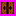

## Mô tả về các đối tượng trong trò chơi

-  *Bomber* là nhân vật chính mà bạn sẽ điều khiển. Bomber có thể di chuyển lên, xuống, trái, phải theo ý người chơi.

-  *Bomb* là vật mà Bomber có thể đặt xuống. Khi Bomb đã được đặt, Bomber không thể đi vào vị trí đó nữa. Tuy nhiên, ngay sau khi đặt Bomb, Bomber được phép đi ra khỏi vị trí vừa đặt Bomb một lần. Sau 2.5 giây, Bomb sẽ tự động phát nổ.

-  *Wall* là bức tường cố định, không thể bị phá hủy bằng Bomb và cũng không thể đặt Bomb lên. Bomber không thể đi xuyên qua Wall.

-  *Brick* là khối gạch không thể đặt Bomb lên, nhưng có thể bị phá hủy nếu Bomb nổ gần đó. Bomber không thể đi qua Brick khi nó chưa bị phá hủy.

-  *Portal* là cổng dịch chuyển, được giấu phía sau một Brick. Khi Brick này bị phá hủy, Portal sẽ xuất hiện. Nếu người chơi đã tiêu diệt hết Enemy, Bomber có thể đi vào Portal để sang Level mới.

*Item* cũng được giấu sau Brick và chỉ xuất hiện khi Brick bị phá hủy. Bomber có thể nhận Item bằng cách đi vào vị trí của Item. Các loại Item gồm:

-  *SpeedItem*: Tăng tốc độ di chuyển cho Bomber.
-  *BombItem*: Tăng thêm 1 Bomb mà Bomber có thể đặt cùng lúc.
-  *FlamePassItem*: Bomber sẽ mặc giáp Vàng, có thể đi qua Flame mà không bị thương.
-  *FlameItem*: Tăng phạm vi nổ của Bomb.
-  *LifeItem*: Tăng thêm 1 mạng cho Bomber.

*Enemy* là các đối thủ mà Bomber cần tiêu diệt để qua Level. Enemy có thể di chuyển ngẫu nhiên hoặc đuổi theo Bomber, tùy loại. Các loại Enemy gồm:

-  *Ballom*: Loại Enemy đơn giản nhất, di chuyển ngẫu nhiên với tốc độ chậm.
-  *Oneal*: Có thể đuổi theo Bomber khi lại gần, tốc độ di chuyển tăng khi đuổi.
-  *Pass*: Di chuyển ngẫu nhiên với tốc độ khá nhanh. Khi bị tiêu diệt sẽ sinh ra thêm 2 *Ballom*.
-  *Dahl*: Tốc độ di chuyển thay đổi, lúc nhanh lúc chậm.
-  *Doria*: Có thể đuổi Bomber khi lại gần với phạm vi rộng hơn Oneal, tốc độ di chuyển tăng và có thể đi xuyên Brick khi đuổi Bomber.
